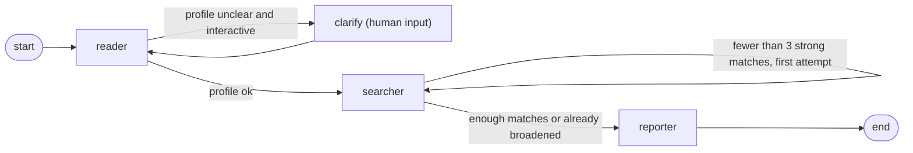

# ScholarPath

ScholarPath helps students find educational opportunities that fit their background and goals: degree programs, scholarships, fellowships, bootcamps and online courses.

A student describes themselves in plain text. Three specialized agents, orchestrated with LangGraph, turn that text into a profile, search for opportunities, and write a grounded advisory report.

## The three agents

| Agent | Reads | Writes | Tools | Never does |
|---|---|---|---|---|
| **Reader** (Profile Analyst) | Raw student text | `StudentProfile` with `missing_fields` and `confidence` | None | Search or write prose |
| **Searcher** (Opportunity Scout) | `StudentProfile` | Ranked `list[Opportunity]` and a `SearchLog` | `search_local_catalog`, `search_web` (optional) | Talk to the student |
| **Reporter** (Advisor) | Profile, ranked opportunities, search log | Markdown report saved to `reports/` | None | Search or name anything not found |

- The **Reader** uses structured output, then applies rules the model cannot be trusted with: GPA normalization to a 0-4 scale, year sanity checks, deduplication, and computing which fields are missing.
- The **Searcher** plans queries in a bounded tool-calling loop (6 calls max). It ranks only what its tools returned, with a transparent score out of 100: subject 40, level 20, cost and funding 20, location and mode 10, GPA 10. Every score carries reasons and concerns.
- The **Reporter** is checked after writing. Every `###` opportunity heading must match an opportunity the Searcher found, and all required sections must exist. On failure it regenerates once with a correction, then fails loudly.

## The graph



- **After the Reader:** if confidence is below 0.5 or the field of study or career goal is missing, and the run is interactive, the graph pauses with a LangGraph `interrupt()` and asks the student a follow-up question. This happens at most once.
- **After the Searcher:** if fewer than 3 opportunities score 50 or more, the Searcher runs once more in broadened mode, without filters and with wider queries.
- State is checkpointed with `MemorySaver`, so an interrupted run resumes on the same thread.

`clarify` is a human-in-the-loop step, not an agent.

## Setup

Requires Python 3.11+.

With uv:

```bash
uv sync
```

With pip:

```bash
python -m venv .venv
.venv/Scripts/activate        # Windows; use source .venv/bin/activate on macOS/Linux
pip install -e ".[dev]"
```

Then copy `.env.example` to `.env` and set `ANTHROPIC_API_KEY`. `TAVILY_API_KEY` is optional and turns on live web search.

To run without any keys, set `SCHOLARPATH_FAKE_LLM=1`. This uses a deterministic, rule-based offline model that speaks the same interface as the real one. It is good for demos and tests, and much weaker than a real model.

## Run

One student:

```bash
python -m scholarpath run --input examples/student_1.txt
```

Ask follow-up questions when the profile is unclear:

```bash
python -m scholarpath run --input examples/student_2.txt --interactive
```

All examples, offline:

```bash
SCHOLARPATH_FAKE_LLM=1 python -m scholarpath demo
```

HTTP API:

```bash
uvicorn scholarpath.api:app --reload
```

```bash
curl -X POST localhost:8000/recommend -H "Content-Type: application/json" -d "{\"text\": \"I study biology and want to become a doctor. I need a scholarship.\"}"
```

The response holds the profile, the ranked opportunities and the report markdown.

## Test

```bash
pytest
```

The suite runs offline with no keys. The single test marked `integration` calls the real API and is skipped unless `ANTHROPIC_API_KEY` is set.

```bash
ruff check . && ruff format --check .
```

## Project layout

```
scholarpath/
  agents/reader.py      Agent 1: prompt, normalization, node
  agents/searcher.py    Agent 2: prompt, tool loop, node
  agents/scoring.py     Searcher's match scoring
  agents/reporter.py    Agent 3: prompt, grounding check, node
  tools/catalog.py      Local catalog search tool
  tools/web_search.py   Tavily web search tool
  graph.py              StateGraph, routing, run_pipeline()
  schemas.py            Pydantic contracts between agents
  state.py              Shared graph state
  llm.py                Model factory
  offline_llm.py        Deterministic offline model
  cli.py, api.py        Interfaces
data/opportunities.json Sample catalog (30 entries)
examples/               Three sample students
tests/                  Offline test suite
```

## Data

`data/opportunities.json` is **sample data**. Names refer to well-known real programs, but deadlines, amounts and rules are simplified and may be out of date. Reports tell students to verify everything on the provider's site.

## Extending

**Add a tool to the Searcher.** Create `scholarpath/tools/<name>.py` with a LangChain `@tool` that returns a list of `Opportunity` dicts. Add it in `default_tools()` in `scholarpath/tools/__init__.py`. The Searcher binds it automatically, and its results flow through the same scoring.

**Add a fourth agent.** Create `scholarpath/agents/<name>.py` with a prompt constant and a `make_<name>(llm)` factory that returns a node function reading and writing `ScholarPathState`. Add any new state keys to `state.py` and new models to `schemas.py`. Then register the node and its edges in `build_graph()`. For example, a "Deadline Tracker" between the Searcher and the Reporter.

**Swap the model.** `get_llm()` in `llm.py` is the only place that creates a model. Any LangChain chat model with tool calling and structured output works.

**Tune behaviour.** Thresholds such as the confidence cutoff, strong-match score, tool call limit and top-k live at the top of `config.py`.
